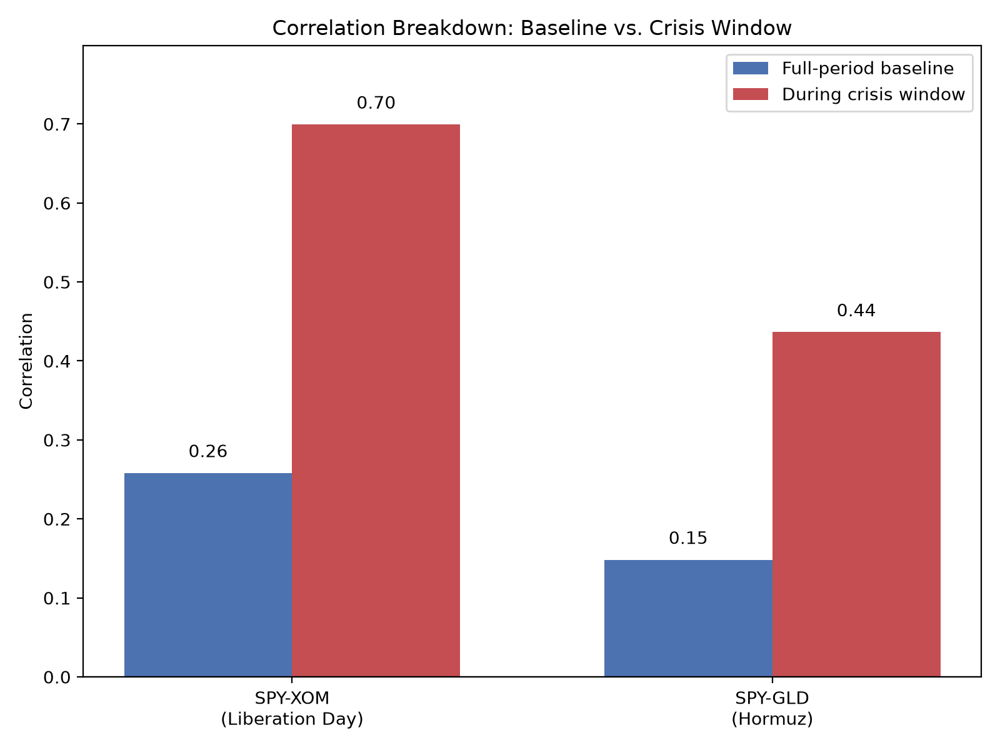
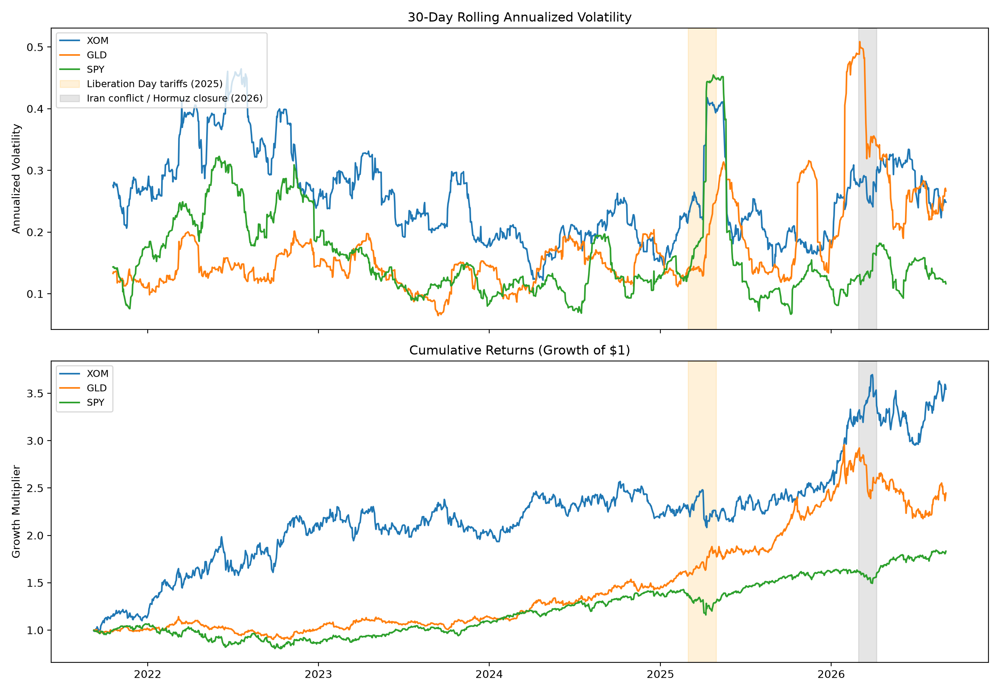

# Financial Market EDA & Signal Analysis

*Cross-asset exploratory analysis, statistical testing, and signal validation on five years of daily market data.*

---

## Quick Facts

| | |
|---|---|
| **Window** | 2021-09-07 to 2026-09-04 (locked, reproducible) |
| **Assets** | SPY, QQQ, GLD, TLT, AAPL, JPM, XOM, JNJ |
| **Core signal tested** | Cross-asset correlation breakdown during market stress |
| **Stack** | `yfinance`, `pandas`, `numpy`, `matplotlib`, `seaborn`, `scipy`, `scikit-learn` |

---

## What This Is

Exploratory data analysis on five years of daily price data across eight assets spanning broad equity indices, sector proxies, and alternative assets.

---

## Data & Methodology
- Source: Yahoo Finance via `yfinance`
- Assets: SPY, QQQ, GLD, TLT, AAPL, JPM, XOM, JNJ
- Period: 2021-09-07 to 2026-09-04, daily, locked to explicit start/end dates rather than a rolling `period='5y'` window, so the dataset is reproducible rather than silently shifting every time the notebook reruns
- Both raw and dividend/split-adjusted close pulled and saved separately. Returns math uses adjusted close; raw close is kept specifically to verify the adjustment is doing something (see Finding 1 below)

Ticker logic, briefly: SPY and QQQ give a broad-market and tech-concentrated view respectively (QQQ tracks the Nasdaq-100, a narrower 100-name index that excludes financials, not the ~3000-name Nasdaq Composite). AAPL, JPM, XOM, and JNJ are single-name proxies meant to separate systematic risk (the whole market moving together) from sector-specific idiosyncratic risk. GLD and TLT add two assets with different risk profiles entirely: commodity/safe-haven demand, and interest-rate/duration risk.

---

## Key Findings

- **JPM, which the Nasdaq-100 categorically excludes by rule, still shows real correlation with QQQ (0.481) purely from macro co-movement, with no structural channel possible.

- **The top Sharpe ratios (XOM 1.09, GLD 1.05) are not evidence that commodities are inherently superior investments over this window.** Both trace to the same real event: the 2026 Iran conflict and Strait of Hormuz closure, which spiked oil (helping XOM) and drove safe-haven flows into gold (helping GLD) near the tail end of the window. This result is very likely window-specific and would not necessarily replicate over a different five-year period.

- **Gold temporarily lost its "safe haven" property during the exact crisis it's supposed to protect against.** Baseline SPY-GLD correlation is low (0.148), consistent with gold acting as a diversifier in calm markets. During the Hormuz crisis window specifically, that correlation jumped to 0.437 (p=0.023), driven by gold being sold for liquidity alongside broader risk assets before recovering. This is a real instance of "correlation breakdown," a documented phenomenon where diversifying assets temporarily move together during acute stress, precisely when diversification is needed most.



- **Two separate, unrelated macro shocks sit inside this window and would look identical on a bare volatility chart.** A 2025 tariff shock ("Liberation Day") and the 2026 Hormuz closure both produced sharp volatility spikes in XOM, but in opposite directions: the tariff shock crashed oil on demand fears, the Hormuz closure spiked it on supply fears. Volatility alone tells you something happened; it doesn't tell you what, why, or which direction, without checking cumulative returns and real dates.



---

## What I Learned / Limitations

Statistical significance and effect size are not the same thing, and this showed up three separate times in Phase 3 alone: Shapiro-Wilk flagged every ticker as non-normal, several weak (0.08-0.17) correlations came back p<0.05, and this is a direct consequence of having roughly 1,255 daily observations per ticker. With that much data, even economically trivial deviations from a null hypothesis become statistically detectable. Effect size, not just the p-value, has to be reported alongside every test in this kind of analysis.

The correlation-breakdown finding, while real and statistically significant, rests on a single crisis episode with a small sample (27-42 trading days). It's a genuine, well-documented instance of the phenomenon, not yet a robust, repeatable law from this dataset alone.

With more time, I'd want to test the correlation-breakdown finding against additional historical crisis windows (2020 COVID crash, 2022 rate-hike selloff) to see whether gold's diversification failure during acute stress is a repeatable pattern or specific to this one event.

---

## How to Run
```bash
git clone https://github.com/egabeckert/financial-market-eda.git
cd financial-market-eda
python3 -m venv .venv
source .venv/bin/activate
pip install -r requirements.txt
python 01_data_collection.py   # regenerates data/ locally, same locked date range
```
Run scripts in order: `01_data_collection` -> `02_returns_analysis` -> `03_statistical_testing` -> `04_signal_analysis`.

`data/` is gitignored. Rerun `01_data_collection.py` to regenerate it; the locked start/end dates guarantee an identical dataset every time.
